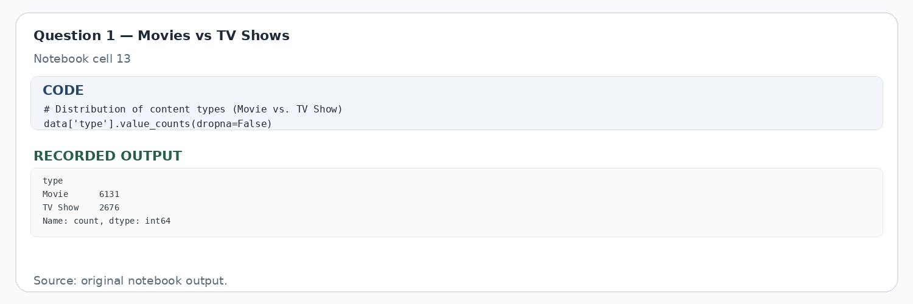
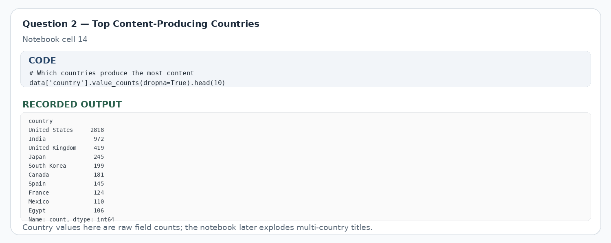
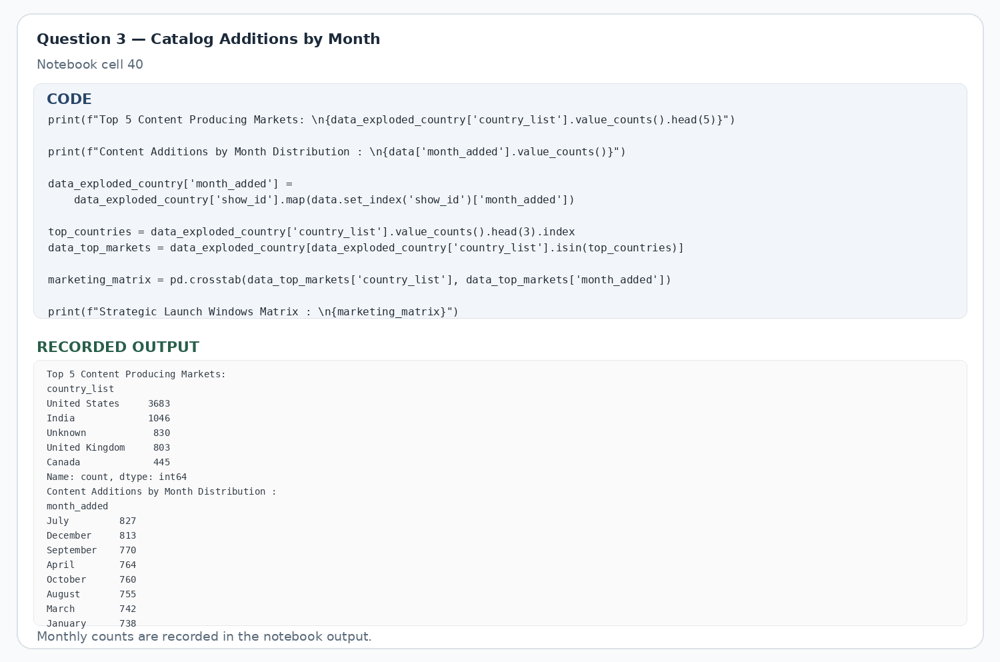
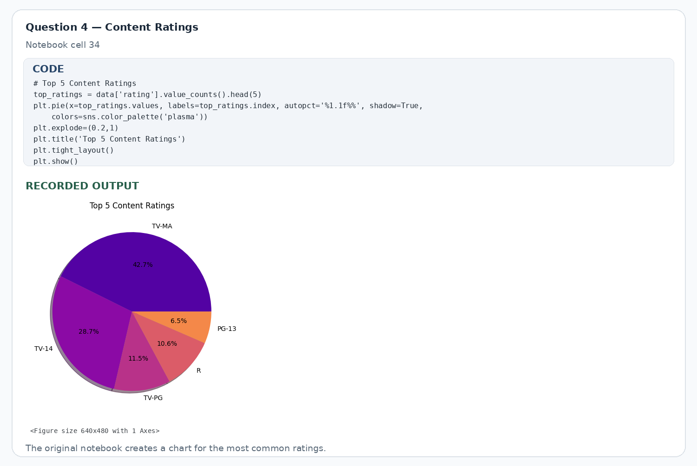
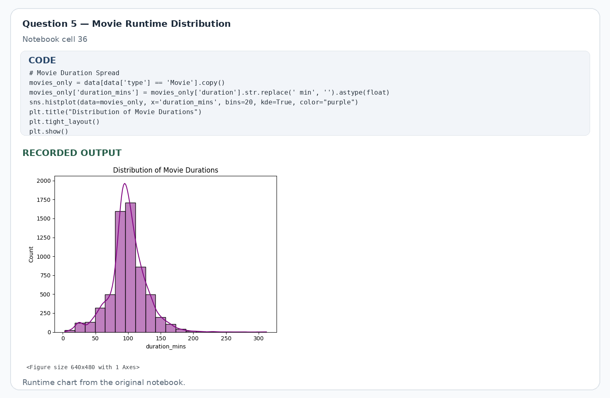
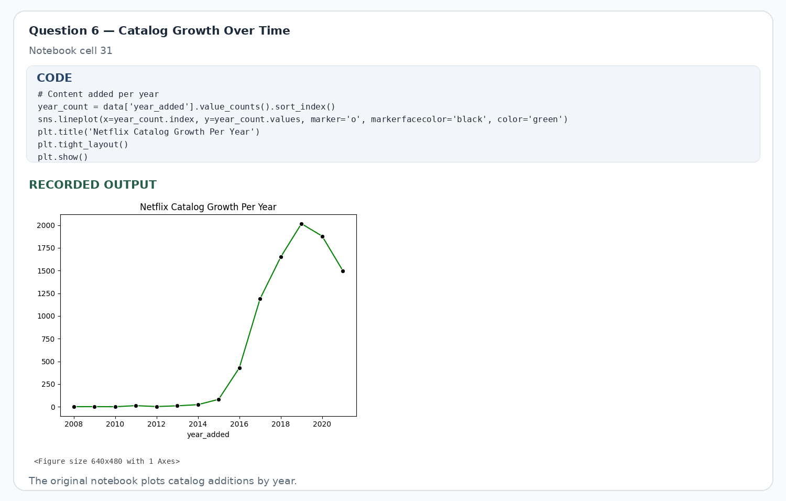
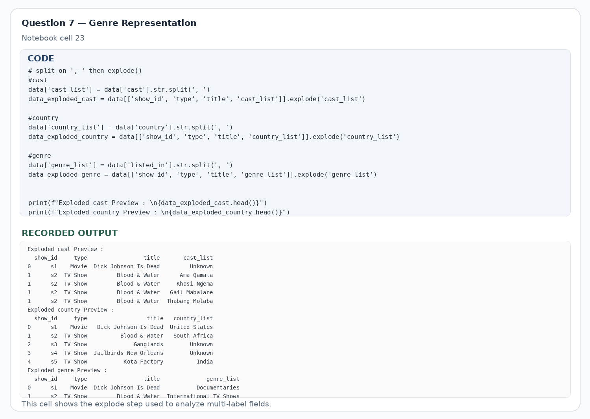

# Business Questions & Answers

Each question below includes a screenshot from the supplied Jupyter Notebook showing the relevant code cell and its recorded output. The screenshots are provided for portfolio review; the source notebook remains included in this repository.

> **Note:** Answers below reflect the original notebook's recorded outputs and written observations. Re-run the analysis against the exact CSV before publishing counts as final.

## 1. Is the Netflix catalog more focused on movies or TV shows?

**Answer:** The notebook reports 6,131 movies and 2,676 TV shows, so movies make up roughly 70% of the catalog records. That tells us what the library contains, but not which format customers prefer.

## 2. Which production countries are most represented?

**Answer:** The notebook's later exploded-country analysis reports the United States with 3,683 title-country mentions and India with 1,046, followed by the United Kingdom (803) and Canada (445). A title can list multiple countries, so these are mentions rather than exclusive country totals.

## 3. When does Netflix add the most titles?

**Answer:** The recorded monthly breakdown has July leading with 827 additions, followed by December (813) and September (770). February has the lowest count at 563. It would be useful to compare these periods with viewing and marketing results before making release-calendar decisions.

## 4. What do ratings suggest about the catalog's intended audience?

**Answer:** The notebook's written observation says TV-MA and TV-14 are the most common ratings. This suggests the catalog metadata leans toward mature audiences, but it doesn't tell us who actually watches the content. Confirm exact shares by rerunning the rating analysis.

## 5. What movie length is most common?

**Answer:** The notebook describes movie durations as clustering around 90–110 minutes. That's a descriptive pattern, not proof that this length maximizes completion or satisfaction. Viewer-level engagement data would be needed to test that.

## 6. Has the catalog expanded over time?

**Answer:** The notebook observes a sharp rise in catalog additions after 2015. This indicates growth in the titles represented in the dataset, not necessarily growth in subscribers, revenue, or viewing hours.

## 7. Which genres are prominent?

**Answer:** The notebook calls out International Movies and Dramas as major genre groups. Each title can carry multiple genre labels, so the counts are genre mentions and may overlap. Run the analysis to calculate exact counts from the dataset.

## What would I recommend to the business?

- **Evaluate content investment with engagement data.** Compare movies and TV shows on completion rate, repeat viewing, and retention before changing budgets.
- **Explore family-content opportunities carefully.** Use audience demand and household engagement—not ratings distribution alone.
- **Test runtime assumptions.** Study whether movie runtime is associated with completion and satisfaction before setting a target.
- **Use monthly addition patterns as a planning clue.** Validate them against viewership, acquisition, and marketing outcomes.

## What data is missing to answer the bigger business question?

The dataset is catalog metadata. It does not contain title views, watch time, completion rate, subscriber churn, acquisition cost, production cost, or revenue. Without those fields, the analysis cannot establish which content choices are most profitable or best at retaining subscribers.
